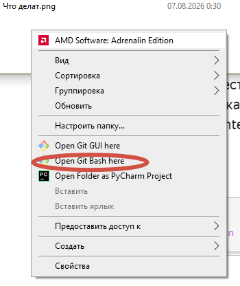
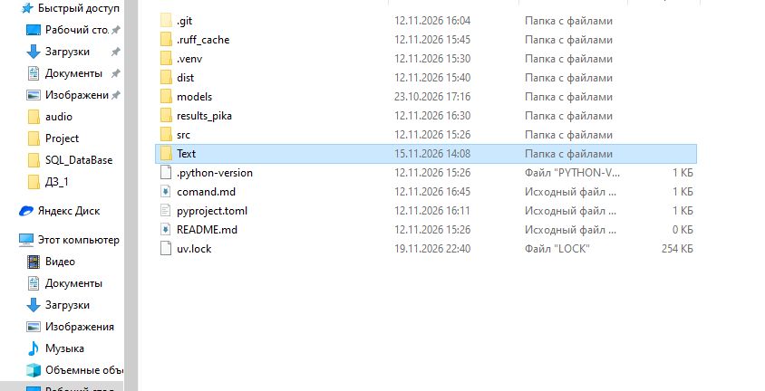

Для начала нужно будет установить git и пакетный менеджер:

    https://git-scm.com/

Гит нам нужен для BASH строки в ней очень удобно работать с консолью.
открывай пустую папку(желательно)

по стандарту если установить git после нажатия правой кнопкой мыши должен появиться такой значок:

пакетный менеджер UV можно установить через BASH: 

    curl -LsSf https://astral.sh/uv/install.sh | sh
 
после 

    uv init --package --name project --python 3.12 .

Получится примерная структура:

    ├── pyproject.toml
    ├── README.md
    ├── .python-version
    └── src
        └── project
            └── __init__.py
 

через GIT Bash запускай для проверки:

    uv run python -m project.main

Должно вывестись hello или чтото что написано в __init__.py

после все настройки главного питоновского файла можно изменить в pyproject.toml

а именно измени автосозданную строку:

    [project.scripts]
    project = "project:main" 

на 
    
    [project.scripts]
    project = "project.main:main" 

тогда при запуске 

    uv run project 
    
у тебя будет запускаться main файл

## теперт когда все подготовленно

можешь удалить все что создано в папке это только для теста разархифируешь мой архив, в папку

после открываешь также правой кнопкой Bash терминал и в нем 

пиши: 

    uv sync

после менеджер скачает все необходимые пакеты и зависимости.

после можно расслабится и все запускать:

    uv run gliner

## теперь о самой директории

папка .venv твоя личная там все зависимости
models лежит сама модель к ней ссылается программа когда запускается

Text в нем 2 папки, в одной входной текст, в другой кешированный.

если папки нет и в ней нет двух текущих папок, то программа будет выдавать,что нет дирректории.
потом это исправлю

и теперь главное код в папке src

- main отвечает за запуск программы и закрузку других подпрограмм и также ожидание следующего текста

- ner_factory_database отвечает за создание класса который как раз берет текст и разбивает его нормализует и все прочее, подробнее могу потом обьясниц, уже сам многое нее помню давно делал.

- postgres_storage отвечает за запись в базу данных сам скрипт запускается из ner_factory_database

    в postgres_storage нужно указать твою базу данных и данные, а то не запишется, создай например такую же базу или свою уже. как хочешь

